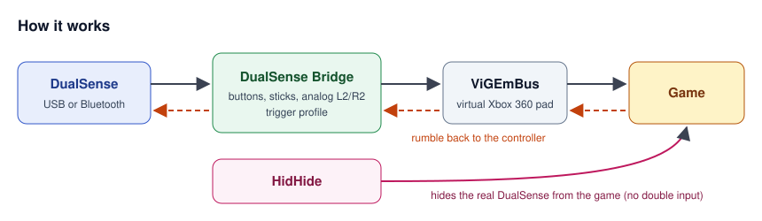

# DualSense Xbox Bridge

A small Windows app that makes a **PS5 DualSense** (or **PS4 DualShock 4**) controller show up as an **Xbox 360 controller**, over **USB or Bluetooth**.

- **Analog triggers** in every Xbox game (L2/R2 go 0–255, not just on/off)
- **Rumble** from the game goes to the DualSense, over USB and Bluetooth
- **No double input**: the real DualSense is hidden from games while Xbox mode is on ([HidHide](https://github.com/nefarius/HidHide))
- **One click to switch back**: turn Xbox mode off and the DualSense is a normal DualSense again, with full native support in games like Silent Hill 2 or Sony's PC ports
- **Trigger profiles (experimental)**: adaptive-trigger feel (resistance, weapon click, buzz) for 50+ games, with several feel presets
- **Trigger kick**: optional short kick in the triggers when the game rumbles (shots, hits)
- **Light bar**: automatic color by mode (green = Xbox mode, blue = off, red = low battery), your own color, or off
- **DualShock 4** works too (mapping, rumble, light bar; adaptive triggers are DualSense-only)
- Auto-reconnect, battery level and low-battery warning, tray icon, start with Windows, update check



## Install

1. Download **`DualSenseBridge-Setup.exe`** from the [Releases](../../releases) page and run it.
2. The setup installs the app and, if they are missing, the two drivers it needs:
   - **[ViGEmBus](https://github.com/nefarius/ViGEmBus)**: creates the virtual Xbox controller (required)
   - **[HidHide](https://github.com/nefarius/HidHide)**: hides the real DualSense while Xbox mode is on (recommended)
3. Restart your PC if the setup asks (after installing HidHide).
4. Start **DualSense Bridge** from the Start menu or the desktop shortcut.
5. (Bluetooth only) Pair the DualSense once: hold **PS + Create** until the light bar flashes, then add it in *Settings → Bluetooth & devices*.

Windows asks for administrator rights on every start because HidHide needs them. Uninstall it from *Settings → Apps* like any other program.

No installer wanted? Download **`DualSenseBridge-portable-x64.zip`**, unzip it and run `DualSenseBridge.exe`. Then install ViGEmBus and HidHide yourself from their release pages.

> ViGEmBus is retired by its author. It still installs and works, but gets no new updates.
>
> Some antivirus programs flag new, unsigned apps by mistake. The source is all here, and every release is built by GitHub Actions from this code.

### Run from source (optional)

Requires Windows 10/11 and Python 3.10+.

1. Download this repository (green **Code** button → **Download ZIP**) and unzip it.
2. Double-click **`scripts\setup.bat`**. It creates a private Python environment, installs `requirements.txt` and puts a **DualSense Bridge** shortcut on your desktop.
   To use a specific Python: `scripts\setup.bat "C:\path\to\python.exe"`
3. To build it yourself: **`scripts\build.bat`** → `dist\DualSenseBridge.exe`, plus `dist\DualSenseBridge-Setup.exe` if [Inno Setup](https://jrsoftware.org/isinfo.php) is installed.

## Use

Start **DualSense Bridge** from the Start menu or desktop shortcut and accept the administrator prompt.

| Part of the window | What it does |
| --- | --- |
| **Controller** | Connection (USB / Bluetooth) and battery. Reconnects on its own. |
| **Xbox mode** | **ON**: games see an Xbox 360 controller, the DualSense is hidden. **OFF**: games see the DualSense as it is. |
| **Trigger profile** | Pick your game (type to search). Effects apply while Xbox mode is on. |
| **Test trigger effects** | Plays every effect for a few seconds; press L2/R2 to feel them. |
| **Live** | Trigger values and the rumble the game is sending. |

The **Settings** tab has the light bar (automatic / your color / off, brightness), the trigger kick, start with Windows, the low-battery warning and the update check.

Closing the window keeps the app in the **tray**. Right-click the tray icon to toggle Xbox mode or quit. The icon is green when Xbox mode is on, grey when off and red when no controller is connected.

**Rule of thumb:** game expects an Xbox controller → Xbox mode **on**. Game supports DualSense natively → Xbox mode **off**, and play over USB.

## Trigger profiles (experimental)

> **These profiles are first guesses.** They are based on each game's default controls and have not been tested in every game. If a profile feels wrong, edit `profiles.json` and please send a pull request.

Profiles live in [`profiles.json`](profiles.json). Each game points to a shared **preset** and can override L2 or R2:

```json
"dead_space": {"_controls": "L2 Aim, R2 Fire", "preset": "shooter_heavy"}
```

| Preset | Feel | Games |
| --- | --- | --- |
| `gun_semi` | L2 aim: light tension. R2: short pull, crisp click right when the shot fires | Atomic Heart, Control, Red Dead Redemption, Red Dead Redemption 2, Resident Evil 2, Resident Evil 3, Resident Evil 4, Resident Evil 7, Resident Evil Requiem, Resident Evil Village |
| `gun_heavy` | L2 aim: firm. R2: longer, heavy pull, then a hard break (shotgun, plasma cutter) | Dead Space |
| `gun_auto` | L2 aim: light. R2: light resistance with a rapid-fire rattle | Apex Legends, Fortnite, Metro 2033 Redux, Metro Exodus, Metro Last Light Redux, Stalker 2, Titanfall 2 |
| `gun_heavy_auto` | R2: heavy machine gun, slow strong pulses | Doom Eternal |
| `melee_swing` | R2 heavy attack: tension builds early, then snaps back like committing to a swing | Control Resonant, Dark Souls 3, Elden Ring, Kingdom Come Deliverance, Kingdom Come Deliverance 2, Sekiro, Silent Hill f |
| `melee_light` | R2 attack: short, light tap of resistance that releases quickly | Silent Hill f Soft |
| `melee_hits` | R2 attack: quick, solid click (blunt weapons, kicks) | Dying Light, Dying Light 2, Dying Light The Beast |
| `charge_hold` | R2 held to charge: resistance grows the deeper you press | Black Myth Wukong, Silent Hill f Charge |
| `bow` | L2 aim: light. R2: string tension rising to the end | Skyrim |
| `force_powers` | Both triggers: smooth resistance that grows, like pushing against a force | Star Wars Jedi Fallen Order, Star Wars Jedi Survivor |
| `power_and_gun` | L2 power hand: crackling buzz. R2 gun: crisp click | BioShock, BioShock 2, BioShock Infinite |
| `flashlight_and_gun` | L2 aim / flashlight: steady tension. R2 gun: crisp click | Alan Wake 2, Alan Wake Remastered |
| `racing` | L2 brake: progressive, gets firm. R2 throttle: light, even spring | Assetto Corsa Competizione, Forza Motorsport |
| `driving_rough` | Racing feel plus a light rumble in the throttle (off-road, trucks) | Euro Truck Simulator 2 |
| `light_all` | Both triggers a little heavier, works in any game | Call of Cthulhu, EA Sports FC, Final Fantasy 7 Rebirth, Final Fantasy 7 Remake, GTA V, Monster Hunter Wilds, Split Fiction |

Some of these games support the DualSense natively on PC (marked `"_native_dualsense": true`, e.g. Star Wars Jedi: Survivor, Final Fantasy VII Remake, Metro Exodus). For those, the game's own effects are better: turn Xbox mode off and play over USB.

**Why clicks sit early:** most Xbox games treat a trigger as pressed at about 12 % of its travel ([XInput threshold 30/255](https://learn.microsoft.com/en-us/windows/win32/api/xinput/ns-xinput-xinput_gamepad)), which is zone 1. A click or snap placed deep in the travel lands *after* the game has already reacted and feels disconnected, so the presets put them in zones 1–4.

**Effect modes** (trigger travel is split into zones 0 = rest to 9 = fully pressed; based on [Nielk1's DualSense trigger effect reference](https://gist.github.com/Nielk1/6d54cc2c00d2201ccb8c2720ad7538db)):

| Mode | Parameters | Feels like |
| --- | --- | --- |
| `off` | – | Normal trigger |
| `feedback` | `start` 0–9, `strength` 1–8 | Even resistance from `start` to the end |
| `slope` | `start`, `end`, `start_strength`, `end_strength` | Resistance that grows (or fades) along the travel |
| `multi` | `strengths`: 10 values 0–8 | Your own resistance curve, zone by zone |
| `weapon` | `start` 2–7, `end`, `strength` | Resistance that breaks with a click, like a gun trigger |
| `bow` | `start` 0–7, `end`, `strength`, `snap` | Tension builds, then the trigger snaps back |
| `vibration` | `start`, `amplitude` 1–8, `frequency` Hz | Trigger buzzes while pressed |
| `machine` | `start`, `end`, `amplitude_a`/`amplitude_b` 0–7, `frequency`, `period` | Buzz that alternates between two strengths |
| `galloping` | `start`, `end`, `first_foot`, `second_foot`, `frequency` | Two-beat pulse, like hooves or an engine |

## Testing

Open **Win+R → `joy.cpl`** (or the **Open joy.cpl** button):

- Xbox mode on → only **Controller (Xbox 360 For Windows)** is listed
- Properties → L2/R2 move the **Z axis** smoothly (this old panel puts both triggers on one axis)
- Buttons: Cross = 1, Circle = 2, Square = 3, Triangle = 4, L1/R1 = 5/6, Create = 7, Options = 8, L3/R3 = 9/10
- Xbox mode off → the DualSense is listed again

## Button mapping

| DualSense | Xbox |
| --- | --- |
| Cross / Circle / Square / Triangle | A / B / X / Y |
| L1 / R1 | LB / RB |
| L2 / R2 | LT / RT (analog 0–255) |
| Create / Options / PS | Back / Start / Guide |
| L3 / R3 | Left / right stick click |
| D-pad | D-pad |
| Touchpad, Mute | not mapped |

## Troubleshooting

| Problem | Fix |
| --- | --- |
| "No controller" | Check the cable or Bluetooth. Close Steam and DS4Windows, they can grab the controller. |
| Cable plugged in but it still says Bluetooth | The DualSense stays on Bluetooth while charging. Turn it off (hold PS ~10 s) or turn PC Bluetooth off, then plug in. |
| Nothing over USB at all | Some USB-C cables only charge. Try a data cable, directly on the PC. |
| Bluetooth stuck in "simple mode", triggers stay 0 | Remove the controller in Windows Bluetooth settings and pair it again. |
| "ViGEmBus / vgamepad not available" | Install ViGEmBus and restart. |
| "DualSense NOT hidden" | Install HidHide and restart. |
| DualSense invisible to games after a crash | Start the app once: it turns hiding off on startup. Or open *HidHide Configuration Client* and untick *Enable device hiding*. |
| Inputs doubled in Steam games | Steam → Settings → Controller → turn off *PlayStation Controller Support*, or per game. |
| An online game rejects the controller | Some anti-cheat systems block virtual controllers; nothing to fix on our side. |

## Command line (optional)

For scripting or debugging, everything also works without the window (run as administrator):

```
.venv\Scripts\python.exe src\bridge.py --profile elden_ring
.venv\Scripts\python.exe src\bridge.py --list
.venv\Scripts\python.exe src\dualsense_reader.py      # raw controller values
.venv\Scripts\python.exe src\trigger_test.py          # cycle the trigger effects
```

## Project layout

```
DualSenseBridge/
├── profiles.json          trigger profiles (edit me)
├── requirements.txt
├── src/
│   ├── app.py             window + tray icon (entry point)
│   ├── engine.py          background thread: connect, map, rumble, triggers, hiding
│   ├── dualsense_reader.py  finds the DualSense, parses USB / Bluetooth reports
│   ├── bridge.py          DualSense → Xbox mapping, command-line bridge
│   ├── output.py          rumble, trigger effects, Bluetooth CRC32
│   ├── hiding.py          HidHide control
│   ├── bridge_profiles.py reads profiles.json
│   └── trigger_test.py    command-line trigger effect test
├── scripts/
│   ├── setup.bat          run from source: venv, packages, desktop shortcut
│   ├── build.bat          build the exe (and the installer if Inno Setup is installed)
│   └── get_drivers.ps1    downloads the ViGEmBus / HidHide installers to bundle
├── installer/DualSenseBridge.iss   Inno Setup script
├── assets/icon.ico
├── docs/how-it-works.svg
└── .github/workflows/release.yml   builds the exe, the installer and the portable zip on every v* tag
```

## Roadmap

- [x] Read the controller over USB and Bluetooth
- [x] Virtual Xbox controller with analog triggers
- [x] Hide the real DualSense while running
- [x] Rumble
- [x] Trigger profiles (experimental)
- [x] Window + tray, auto-reconnect
- [x] Single `.exe` (no Python needed), built by GitHub Actions
- [x] Installer that also installs ViGEmBus / HidHide
- [x] Light bar colors, low-battery warning, update check
- [x] Trigger kick on in-game rumble
- [x] DualShock 4 support (untested on hardware so far: reports welcome)
- [ ] Automatic profile per game (detect the running game)
- [ ] Profile editor with live preview
- [ ] Gyro aiming, stick deadzones, button remapping

## Credits

The installer bundles the unmodified ViGEmBus (BSD-3-Clause) and HidHide (MIT) installers from Nefarius Software Solutions.


Built on [hidapi](https://github.com/trezor/cython-hidapi), [vgamepad](https://github.com/yannbouteiller/vgamepad), [ViGEmBus](https://github.com/nefarius/ViGEmBus) and [HidHide](https://github.com/nefarius/HidHide). DualSense report layouts follow the Linux `hid-playstation` driver and community documentation.

Not affiliated with Sony or Microsoft. DualSense and PlayStation are trademarks of Sony Interactive Entertainment; Xbox is a trademark of Microsoft.

## License

[MIT](LICENSE)
